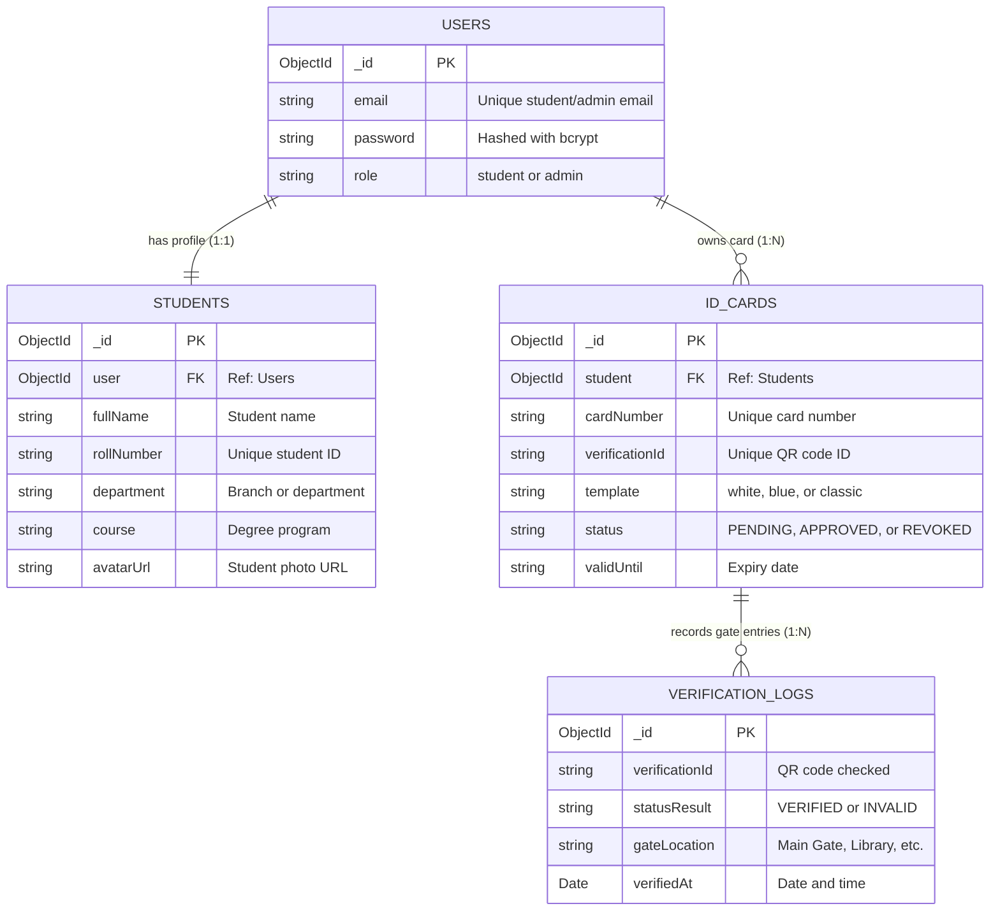

# CampusCard — Digital Student ID Card & Attendance System

> A simple, clean, and modern MERN Stack platform for creating and verifying vertical student ID cards.

[](https://react.dev/)
[](https://vitejs.dev/)
[](https://tailwindcss.com/)
[](https://nodejs.org/)
[](https://expressjs.com/)
[](https://www.mongodb.com/)
[-blue.svg)](https://en.wikipedia.org/wiki/ISO/IEC_7810)

---

## 1. What is CampusCard?

CampusCard is a digital student ID card system built for colleges and universities.

### Common Problems with Traditional ID Cards:
1. **Wrong Orientation on Neck Lanyards:** Horizontal (landscape) cards flip over and hang awkwardly on students' necks.
2. **Easy to Fake:** Paper cards or printed PDFs can easily be modified using photo editing apps.
3. **Cannot Be Cancelled Easily:** If a student drops out or is suspended, their physical card still looks valid.
4. **No Gate Entry Records:** Colleges cannot easily track when students enter the campus or library.

### How CampusCard Solves This:
- **Standing (Vertical) ID Card:** Designed in standard credit card portrait size ($54 \times 86\text{ mm}$) with a top slot for neck lanyards.
- **Smart QR Code Verification:** Each card has a QR code on the back. When scanned with any mobile camera, it opens a page showing if the student is currently enrolled and active.
- **3 Simple Card Styles:** Students can preview their card in 3 clean styles (Clean White, Modern Blue, and Classic Card) with a 3D flip.
- **Print-Ready PDF Download:** Export high-quality vertical PDFs to print directly onto physical PVC cards.
- **Campus Gate Check:** Simulate student entry at the Main Gate, Library, or Computer Labs with sound feedback.
- **Teacher / Admin Dashboard:** College staff can review student photos, approve new cards, or cancel invalid cards in one click.

---

## 2. Technology Used (MERN Stack)

| Part | Technology | What It Does |
| :--- | :--- | :--- |
| **Frontend** | React 18 + Vite | Builds the fast Single Page Application (SPA) with live 3D card preview. |
| **Styling** | Tailwind CSS v3 | Minimal, clean design system with vertical card layouts. |
| **Backend** | Node.js + Express.js | Handles user login, student profiles, card generation, and QR scan APIs. |
| **Database** | MongoDB + Mongoose | Stores users, student details, card statuses, and gate entry logs. |
| **Security** | JWT + Bcrypt | Secures passwords with 12-round hashing and keeps user login sessions safe. |
| **PDF Export** | html2canvas + jsPDF | Compiles vertical ID cards into high-resolution print-ready PDFs ($54 \times 86\text{ mm}$). |

---

## 3. Database Design



---

## 4. How to Run the Project Locally

### Step 1: Install Dependencies
Open your terminal and install packages for both client and server:
```bash
# Frontend
cd client
npm install

# Backend
cd ../server
npm install
```

### Step 2: Configure MongoDB Atlas Database
In `server/.env`, set your MongoDB Atlas connection string:
```env
MONGO_URI=mongodb+srv://<username>:<password>@cluster0.xxxxx.mongodb.net/campuspass?retryWrites=true&w=majority
```

Test your database connection anytime:
```bash
# Test from root:
npm run test:db

# Or test from server folder:
cd server
npm run test:db
```

### Step 3: Start Both Servers
From the project folder, run:
```bash
npm run dev
```

This starts:
- **Frontend Website:** [http://localhost:5173](http://localhost:5173)
- **Backend API:** [http://localhost:5000](http://localhost:5000)

---

## 5. Ready-To-Use Demo Accounts & Portals

- **Student Portal:** [http://localhost:5173/login](http://localhost:5173/login)
  - **Student Demo:** `daniel.miller@gtu.edu` / `StudentPass123!`
  - Create new student accounts at `/register`.

- **Dedicated Admin Security Console:** [http://localhost:5173/admin-login](http://localhost:5173/admin-login)
  - **Admin Demo:** `admin@gtu.edu` or `admin@campuspass.edu` / `AdminPassword123!`
  - **Create New Admin:** [http://localhost:5173/admin-register](http://localhost:5173/admin-register)
  - **Admin Security Passkey:** `CAMPUS_ADMIN_2026`
  - Admins can also provision new admins directly inside the **Admin Dashboard** (`/admin`).

---

## 6. License
MIT License. Created as a modern, clean MERN Stack academic project.
